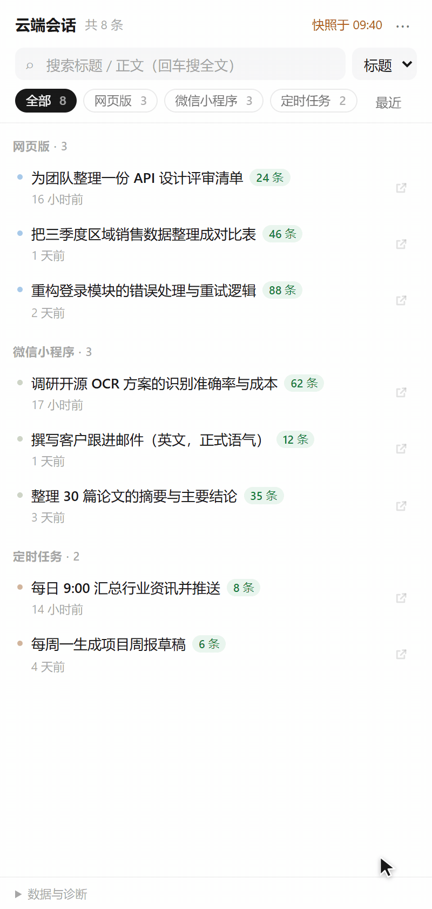
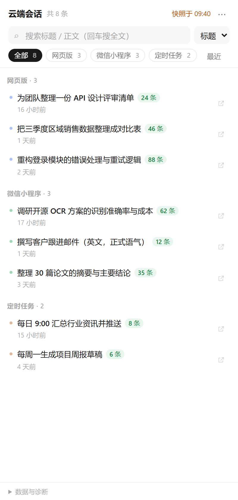
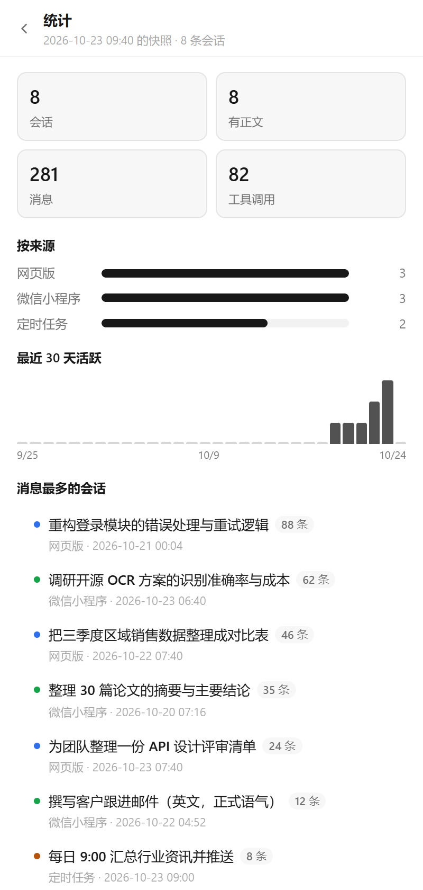
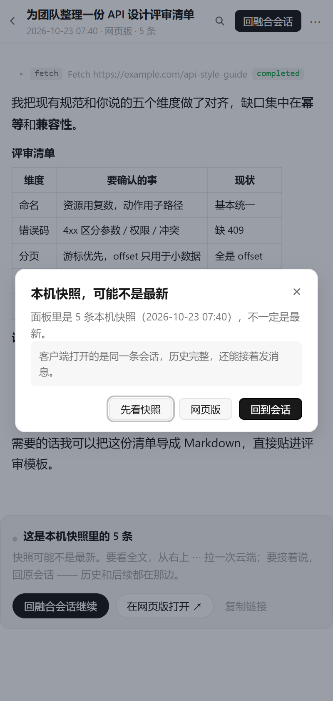
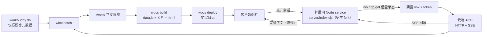

<div align="center">

# 云端会话 · Cloud Sessions

**WorkBuddy 桌面端看不见的那些会话 —— 现在在侧栏里就能读全文。**

网页版、微信小程序、定时任务里跑过的对话，桌面客户端只留了标题，正文一份都没落盘。
这个扩展借你自己的登录态把正文拉回来：点开就是云端回放的最新全文，能搜、能导出，还能一键跳回去接着说。

[](https://github.com/yhm138/workbuddy-toolkit/releases)
[](https://github.com/yhm138/workbuddy-toolkit/actions/workflows/ci.yml)
[](https://github.com/yhm138/workbuddy-toolkit/stargazers)
[](LICENSE)
[](#%E4%BB%8E%E6%BA%90%E7%A0%81%E5%AE%89%E8%A3%85)



<sub>列表 → 云端正文 → 一键回融合会话接着说（客户端一侧为示意画面：深链打开的是<b>同一条 Session</b>）</sub>

</div>

---

## 30 秒看懂

WorkBuddy 桌面客户端里，`DesktopCloudTaskEntry` 这个特性开关在打包时被写死成 `false`：

```js
createProductFeatureHook({ featureKey: 'DesktopCloudTaskEntry', resolve: () => false })
```

于是侧栏永远不请求 `cloud` 空间的会话；而本地 `workbuddy.db` 里**只有标题这类元数据，正文一份都没落盘**——正文只在云端，靠 ACP 协议回放。结果就是：你在手机上、小程序里、定时任务里聊过的东西，回到电脑前等于消失了。

| | 原生桌面端 | 装了这个扩展 |
| --- | --- | --- |
| 侧栏列出云端会话 | ❌ 开关写死 | ✅ 按来源分组、带条数与时间 |
| 点开读全文 | ❌ 只有标题 | ✅ **云端回放的最新正文**，不用扫码 |
| 小程序 / 网页版会话 | ❌ 打开是「暂无对话记录」 | ✅ 直接回放（客户端自己都读不到） |
| 跨会话搜正文 | ❌ | ✅ 命中高亮，点进去滚到那条消息 |
| 导出 Markdown | ❌ | ✅ 单条复制 / 全量导出 |
| 接着说下去 | — | ✅ 回融合会话（同一个 Session）或网页版 |

> 全程只读：不改 `workbuddy.db`、不改 `app.asar`。抓的是你自己的账号、你自己的会话，数据只落在你本机。

---

## 下载即用

**[⬇ 下载 Windows 便携版](https://github.com/yhm138/workbuddy-toolkit/releases)**（约 37 MB，自带 Node 运行时，**不用装 Node、不用 npm install**）

解压到任意目录，然后：

1. **先完全退出 WorkBuddy** —— 右下角托盘图标右键 → 退出（只关窗口不算）
2. **双击 `安装.bat`**（同目录的 `install.bat` 是同一个东西），跟着窗口里的中文提示走：扫码登录一次 → 选抓多少条（默认最近 30 条）
3. 重新打开 WorkBuddy → 左侧菜单点「云端会话」

浏览器复用系统里的 Chrome / Edge（Windows 自带 Edge）。卸载双击 `uninstall.bat`，会顺带问你要不要删登录态。

> 扩展装在 `…/resources/app.asar.unpacked/resources/extensions/cloud-sessions`，
> 数据放在 `%LOCALAPPDATA%\wbcs`，覆盖安装新版本不会丢。

<details>
<summary><b>双击 <code>安装.bat</code> 窗口一闪就没 / 提示需要管理员权限</b></summary>

- 一闪就没：`runtime\node.exe` 没解出来。重新下载 zip，用「全部解压」，别把里面的文件直接拖出来。
- 要管理员权限：客户端装在 `C:\Program Files` 下就会这样。右键 →「以管理员身份运行」。
</details>

---

## 它能做什么

| 能力 | 说明 |
| --- | --- |
| **云端直连** | 扩展里 fork 一个 Node service，借**宿主自己的 cookie** 现场回放：不用扫码、不依赖浏览器 profile，点开就是最新 |
| **边拉边画** | 回放是流式的，面板每 280ms 取一次已解析消息，**第一段正文 1 秒内出现**，底部显示「已到 N 条 · 后面还在补」 |
| **按来源分组** | 网页版 / 微信小程序 / App / 定时任务，各带条数徽标 |
| **完整正文** | 用户消息右侧浅块、助手文档流；标题、列表、**表格**、代码块正常渲染 |
| **工具调用折叠** | `fetch` / `execute` / `search` 收成一行，点开看输入与输出 |
| **全文搜索** | 跨会话搜正文，命中高亮，点进去自动滚到那条消息 |
| **会话内查找** | `Ctrl+F`，上/下跳转，命中计数 |
| **继续对话** | 正文末尾给两条出口：**回融合会话**（`workbuddy://chat/<id>` 深链，同一个 Session）或**网页版**（系统浏览器） |
| **自动同步** | 每次点进面板自动拉一遍云端列表（60 秒节流），新会话顺手补正文，不用手动点 |
| **补全正文** | `⋯ → 补全云端正文`，把还没正文的逐条回放下来（带进度、可中断） |
| **导出** | 单条复制为 Markdown，或全量导出到 `export/`（含 `INDEX.md`） |
| **收藏 / 排序 / 统计** | 收藏置顶、按时间或条数排序、来源分布与 30 天活跃曲线 |
| **深链** | `#/s/<id>` 直达某条会话，可当书签 |

<p align="center">
  
  
  
</p>
<p align="center">
  <sub>左：按来源分组（网页版 / 小程序 / 定时任务，各带条数）　·　中：完整正文，表格、工具调用、思考过程都在　·　右：来源分布与 30 天活跃度</sub>
</p>

<p align="center">
  
</p>
<p align="center">
  <sub>service 没起来时的降级提示：正文退回本机快照，明确标「可能不是最新」，点遮罩不关闭、必须显式确认</sub>
</p>

快捷键：`/` 搜索 · `↑↓` 选择 · `Enter` 打开 · `Esc` 返回 · `Ctrl+F` 会话内查找 · `?` 统计

> 截图与动图都由 `node tools/demo-shots.js` / `node tools/demo-gif.js` 用**内置示例数据**渲染，不含任何真实会话。

---

## 只读边界（这条要提前讲清楚）

面板是**浏览层，不是第二个聊天客户端**。它能做的和不能做的：

| 能力 | 面板内 | 说明 |
| --- | --- | --- |
| 读最新正文 | ✅ service 在跑时 | 正文顶上标「云端最新 · hh:mm（N 个事件）」 |
| 读历史正文 | ✅ 退回本机快照 | service 不可用时自动降级，标「本机快照 · 可能不是最新」并弹一次说明 |
| 全文搜索 | ✅ 快照 + 本次从云端拉过的 | 只搜「手上已有的正文」，不会偷偷替你联网扫全库 |
| 继续对话 | ✅ 两条路 | 回融合会话（同一个 Session）或网页版 |
| **在面板里发消息** | ❌ **不做** | 见下 |
| 重复打开同一条 | ⚡ 秒开 | 3 分钟内命中缓存；云端 `updatedAt` 没变则 30 分钟内都复用 |

**为什么不做输入框？** 不是偷懒。宿主的 `wb:message:fill` 只有 `content / mode / scene` 三个参数，`sidebarUrl` 在源码里被写死成空串——它的语义是「切到一个新建草稿」，**没有目标会话**。也就是说，你在面板里敲的字永远进不了那条会话，跳过去输入框是空的。与其假装能输入、把你的话弄丢，不如把「去哪儿接着说」写在正文末尾。

同理，两种顶部提示不能合并：「**云端最新**」是真·最新，「**本机快照**」是降级——把它俩说成一样，人就会把半截对话当成全部，那比看不到更糟。

---

## 从源码安装

前置：Node 18+（抓正文建议 22+，读 SQLite 用的是内置 `node:sqlite`），WorkBuddy 桌面端登录过一次。**macOS / Linux 走这条路。**

```bash
git clone https://github.com/yhm138/workbuddy-toolkit.git
cd workbuddy-cloud-sessions
npm install
node bin/wbcs.js install        # 向导：查环境 → 登录 → 抓取 → 构建 → 部署
```

分步来也行（`npx playwright install chromium` 只在系统里既没 Chrome 也没 Edge 时需要）：

```bash
node bin/wbcs.js login               # 弹浏览器，扫码一次，登录态长期复用
node bin/wbcs.js fetch --limit 30    # 抓正文
node bin/wbcs.js build               # 生成静态数据
node bin/wbcs.js deploy              # 装进客户端
```

只想先看效果、不装扩展：

```bash
node bin/wbcs.js fetch --limit 5 && node bin/wbcs.js build && node bin/wbcs.js serve
# → http://127.0.0.1:8787/
```

装完必须**完全退出**客户端（托盘右键退出）再打开，左侧菜单才会多出「云端会话」。

<details>
<summary><b>命令一览</b></summary>

| 命令 | 作用 |
| --- | --- |
| `wbcs install` | 一键向导（`--yes` 全默认，`--skip-fetch` 只装面板） |
| `wbcs uninstall` | 从客户端移除扩展，可顺带删 `WBCS_HOME` |
| `wbcs login` | 扫码登录，登录态存 `.wbcs/profile` |
| `wbcs list` | 只读本地 DB，列出有哪些云端会话（不联网） |
| `wbcs fetch` | 抓正文，`--limit N` / `--only id1,id2` / `--force` / `--idle 4000` |
| `wbcs build` | 生成 `ui/data.js` + 正文分片 + 搜索索引 |
| `wbcs deploy` | 装进客户端扩展目录（自动探测，`--dest` 指定）；客户端在跑会拒绝，`--force` 强制热更新 |
| `wbcs export` | 导出 Markdown 到 `export/` |
| `wbcs serve` | 本地静态预览，`--port` 改端口 |
| `wbcs all` | `fetch` + `build` + `deploy` |

环境变量：`WBCS_HOME`（数据目录）、`WBCS_DB`（`workbuddy.db` 路径）、`WBCS_EXT_DIR`（扩展目录）、`WORKBUDDY_RESOURCES_PATH`、`WBCS_DEBUG`（详细诊断）。

</details>

---

## 工作原理



两条路并存：**快照**负责「打开就有、离线可读、可搜索导出」，**service** 负责「打开就是最新」。service 没起来（老客户端、fork 被安全软件拦）时整体退回快照模式，功能不缺，只是会标「本机快照」。

<details>
<summary><b>为什么面板里拉不动正文（以及为什么需要 fork 一个 Node 进程）</b></summary>

正文不走 REST，走 **ACP（Agent Client Protocol）over HTTP + SSE**：

1. `GET /console/as/conversations/{id}/session` → 拿到消息服务地址 `link` 和沙箱 JWT
2. `GET {link}`，`accept: text/event-stream` 建长连接 → **响应头下发 `acp-connection-id`**
3. `POST {link}` 发 `initialize` + `session/load`，历史以 `session/update` 事件回放

最容易踩的坑：不带 `acp-connection-id` 的 POST 一律 `404 connection not found`；SSE 没 ready 就 POST 也一样。

面板是个 iframe，在浏览器里走不通：网关不回 `access-control-allow-origin`、也不 expose `acp-connection-id`，`fetch` 一律被 CORS 拦死。所以扩展声明了一个 fork 出来的 Node service：

1. 宿主 fork 子进程并调 `activate(wb)`；`wb.http.get` **自带宿主的登录 cookie**
2. 换票据 → 真 Node 建 SSE（没有 CORS）→ POST 带上 `acp-connection-id` 回放
3. 面板通过 `wb:extensions:$resolveLocalRpc` + `$invokeLocalRpcFallback` 调 `fetchBody` / `peek`

顺带的好处：**不用扫码，也不依赖 Playwright profile**——借的是客户端自己的登录态。

并发闸门 2 条、内存缓存 3 分钟、票据过期自动重换。协议细节、`activate` 返回值、`processPolicy` 写法、踩过的 6 个坑，都在 **[docs/PROTOCOL.md](docs/PROTOCOL.md)**。
</details>

---

## 数据与隐私

- 登录态、抓取结果、导出文件都在 `.wbcs/` 和 `export/`，**已被 `.gitignore` 排除**
- 构建产物 `ui/data.js`、`ui/full/` 同样不提交；打包脚本发现它们会直接拒绝
- 全程只读：不改 `workbuddy.db`，不改 `app.asar`（改二进制会让客户端启动闪退）
- 唯一写入的地方是扩展目录 `…/app.asar.unpacked/resources/extensions/cloud-sessions/`
- 没有任何遥测、没有中转服务器：所有请求都是你的机器直连 WorkBuddy 网关

---

## 常见问题

**正文顶部写「本机快照」，不是「云端最新」**
service 没起来，面板降级了。看页脚「数据与诊断」的「云端直连」一行，`不可用 —— …` 后面就是原因：多半是扩展目录是旧版本（`wbcs deploy` 后**托盘退出**再开）、客户端太老不认识 `service` 声明，或 fork 被安全软件拦掉。

**显示 service 活着，但拉正文报 `NO_TICKET`**
宿主登录态过期了。在客户端里随便打开一个会话、或重新登录一次即可。这条链路借的是**客户端自己的 cookie**，不读 `.wbcs/profile`，所以 `wbcs login` 对它没影响。

**某条会话点开是空的**
纯定时任务的会话本来就没有对话记录。小程序 / App 来源的会话则是「客户端不加载这类历史」——面板能回放，客户端里那条永远是空的，用网页版。

**菜单里没有「云端会话」**
`wbcs deploy` 会自动探测安装目录，失败时用 `--dest` 指到 `…/app.asar.unpacked/resources/extensions`。装完必须完全退出客户端。

> 其余症状（插件加载失败、抓取卡住、中文乱码、数据怎么重置……）都在
> **[docs/TROUBLESHOOTING.md](docs/TROUBLESHOOTING.md)**，按「症状 → 原因 → 处理」查。

---

## 开发

```bash
npm test                    # guest-ready 握手自检（真实 Chrome/Edge）
npm run test:service        # service 端到端自测（假网关，不联网、不用登录）
npm run test:panel          # 面板 + service 联调（Playwright，假宿主；NO_SERVICE=1 测降级）
npm run release             # 生成 dist/*-win-x64.zip（需要 zip / unzip）
npm run shots               # 重新生成 docs/images/*.png
npm run gif                 # 重新录 docs/images/continue.gif（逐帧截图 + ffmpeg，需装 ffmpeg）
```

版本号必须五处一致：`package.json`、`extension.json`、`distribution.json`、`server/index.cjs` 的 `VERSION`、页面里的 `PAGE_VERSION`。`wbcs build` 与 CI 都会校验。

代码约定、PR 清单、发布流程见 **[CONTRIBUTING.md](CONTRIBUTING.md)**。

<details>
<summary><b>目录结构</b></summary>

```
bin/wbcs.js            CLI 入口
src/config.js          路径与平台探测（扩展目录自动发现）
src/db.js              读 workbuddy.db（node:sqlite，只读）
src/browser.js         浏览器兜底链：Chrome → Edge → 本机 Chromium → 自带
src/auth.js            Playwright 持久登录
src/acp.js             ACP over HTTP + SSE 客户端（CLI 用，转发到 server/）
src/parse.js           session/update → 扁平消息结构（同上）
src/fetch.js           全量抓取（增量、原子落盘）
src/build.js           生成 data.js / 正文分片 / 搜索索引
src/deploy.js          安装为内置扩展
src/install.js         一键安装 / 卸载向导
src/serve.js           本地预览服务
src/export.js          Markdown 导出
server/index.cjs       扩展内 service（宿主 fork）：票据 → SSE → 分片
server/acp.cjs         ACP 客户端（唯一实现，service 与 CLI 共用）
server/parse.cjs       事件解析（唯一实现）
ui/index.html          扩展页面（零依赖，纯原生 JS）
tools/build-release.js 打 Windows 便携包（自带 node.exe）
tools/release/         安装包里的 install.bat / uninstall.bat / 使用说明
tools/demo-shots.js    用示例数据生成 README 截图
test/mock-gateway.cjs  假 ACP 网关（零依赖，自测用）
test/service-acp.js    service 端到端自测
test/panel-service.js  面板 + service 联调（Playwright，假宿主 + 假网关）
docs/                  架构 / 协议 / 逆向 / 排障（见下方「文档」）
```
</details>

---

## 文档

| 文档 | 讲什么 |
| --- | --- |
| [docs/ARCHITECTURE.md](docs/ARCHITECTURE.md) | 三层职责、数据形状、service 契约、降级矩阵、性能预算 |
| [docs/REVERSE-ENGINEERING.md](docs/REVERSE-ENGINEERING.md) | 一个写死的 `false` 引出的整条链路，以及走过的弯路 |
| [docs/PROTOCOL.md](docs/PROTOCOL.md) | 协议事实清单：扩展加载、guest-ready、ACP、深链、`wb:*` 通道 |
| [docs/TROUBLESHOOTING.md](docs/TROUBLESHOOTING.md) | 症状 → 原因 → 处理 |
| [CHANGELOG.md](CHANGELOG.md) | 每个版本改了什么 |
| [CONTRIBUTING.md](CONTRIBUTING.md) | 本地开发、测试替身、代码约定、发布流程 |


---

## English

An unofficial WorkBuddy desktop extension that makes **cloud-only conversations** (web, WeChat mini-program, scheduled tasks) readable in the sidebar.

The desktop client ships with the `DesktopCloudTaskEntry` feature flag hard-coded to `false`, and the local SQLite DB stores metadata only — message bodies live in the cloud and are replayed over **ACP (HTTP + SSE)**. This project fetches them with your own session, builds a zero-dependency local snapshot, and forks a Node service inside the extension so a click shows the **latest** transcript without any QR login. Read-only, local-first, no telemetry.

See **[docs/PROTOCOL.md](docs/PROTOCOL.md)** for the reverse-engineering notes.

---

## 声明

非官方工具，与 WorkBuddy 官方无关；靠逆向客户端行为实现，仅用于读取**自己账号**的历史会话。

如果官方哪天开放了云端会话入口，这个项目就该退休了 —— 那才是正确的解法。

[MIT License](LICENSE)

<div align="center">

**如果它帮你找回了一段以为丢了的对话，点个 ⭐ 就是最好的支持。**

</div>
