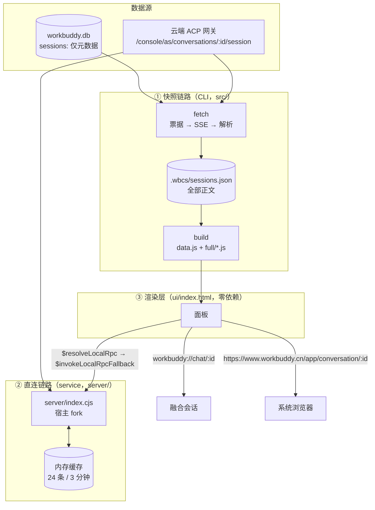

# 架构说明

一句话：**一条只读的数据管线，加一个能借宿主登录态的 Node 侧车（sidecar）。**

面板本身只是 iframe 里的静态页 —— 它自己既读不到 SQLite，也连不上 ACP（CORS 拦死）。所以能力全部落在两个进程里：CLI（离线抓取）和扩展内的 service（在线回放）。



---

## 1. 三层职责

| 层 | 住哪里 | 干什么 | 不该干什么 |
| --- | --- | --- | --- |
| **采集** | `src/fetch.js` → `server/acp.cjs` | 换票据、建 SSE、发 `initialize` + `session/load`、收事件 | 不做渲染，不碰 UI 状态 |
| **存储** | `.wbcs/sessions.json`（单文件） | 全量正文快照，原子落盘（写 `tmp` 再 rename） | 不写 `workbuddy.db`，不写 `app.asar` |
| **呈现** | `ui/index.html` | 渲染、搜索、收藏、导出、跳转 | 不联网（只通过 service 或深链） |

`server/` 里的 `acp.cjs` / `parse.cjs` 是**唯一实现**，`src/acp.js` / `src/parse.js` 只是转发。这样 CLI 和 service 不会跑出两套行为 —— 这是 v1.9 踩过的坑（两份代码修一份、另一份继续错）。

---

## 2. 数据形状

### 落盘：`.wbcs/sessions.json`

```jsonc
{
  "version": 1,
  "fetchedAt": 1761200000000,
  "items": {
    "2070359399505326080": {
      "id": "2070359399505326080",
      "title": "为团队整理一份 API 设计评审清单",
      "fetchedAt": 1761200000000,
      "reason": "idle",              // 收尾原因：idle / sse-end / max / sse-4xx
      "events": 142,                 // 原始 ACP 事件数
      "messages": [ /* 见下 */ ],
      "stats": { "user": 3, "assistant": 5, "thought": 2, "tool": 6 }
    }
  }
}
```

### 消息（刻意用单字母，省字节）

```jsonc
{ "r": "user|assistant|thought|tool",
  "t": "正文（已截断）",
  "k": "tool 的种类", "n": "工具名", "s": "completed|failed",
  "i": "入参", "o": "输出" }
```

截断上限写在 `server/parse.cjs`：正文 24000 字、入参 4000、输出 8000。
一条会话最多回给面板 `MAX_MESSAGES = 6000` 条（再多 IPC 会卡），超出只留尾部并标记 `truncated`。

### 构建产物

```
ui/data.js           列表 + 元数据 + 搜索摘要（一次加载）
ui/full/<id>.js      单条会话正文分片（点开才加载）
ui/full/index.js     分片索引（字节大小，用于进度）
ui/full/_search.js   全量搜索索引（体积大，懒加载）
```

分片的意义：30 条会话的正文可能有几十 MB，全塞进一个 `data.js` 会让面板启动卡死。现在点开哪条才拉哪条。

---

## 3. service 契约

面板调 service 要**两跳**：

```js
const { fallbackToken } = await wb.call("wb:extensions:$resolveLocalRpc", EXT_ID, "fetchBody");
const res = await wb.call("wb:extensions:$invokeLocalRpcFallback", EXT_ID, "fetchBody", payload, fallbackToken);
```

票据 5 分钟过期，`methods` 列表在 `$resolveLocalRpc` 的返回里；失败码 `PERMISSION_DENIED` / `EXTENSION_CONTEXT_STALE` / `EXTENSION_LOCAL_RPC_BUSY` / `INVALID_ARGUMENT`。

暴露的方法：

| 方法 | 用途 | 关键返回 |
| --- | --- | --- |
| `ping` | 探活（不带参数） | `{ ok, version, pid, uptime, ports }` |
| `status` | 诊断页用 | 缓存条目、进行中、并发闸门、最近 12 次调用形状 |
| `inspect` | 查某条会话的票据是否可换 | `{ ok, hasTicket, sessionId }` |
| `fetchBody` | 一次性拿完整正文 | `{ ok, shard, cached, elapsed }` |
| `peek` | **边回放边取**，面板 280ms 轮询 | `{ ok, live, n, messages, events }` |
| `warm` | 预热到网关的 TLS 连接 | `{ ok, warmed }` |
| `clear` | 清缓存（强制下次走网络） | `{ ok, cleared }` |

**参数约定（v1.9.1 的 bug）**：宿主调用 `transport.invoke(method, context, ...args)`，**第一个参数永远是 context**。没 caller 时它是 `{callerId: undefined}` —— 键在、值不在。所以判「有没有 payload」只能看**键是否存在**，不能看值是否 `undefined`。

---

## 4. 降级矩阵

| 场景 | 面板行为 | 顶部提示 |
| --- | --- | --- |
| service 在跑 + 云端有正文 | 流式回放，边拉边画 | 「云端回放中 · 已到 N 条」→「云端最新」 |
| service 在跑 + 云端确实没正文 | 展示快照（若有）+ 落地卡 | 「本机快照」 |
| service 起不来（老客户端 / fork 被拦） | 全部走快照 | 「本机快照 · 可能不是最新」+ 一次性弹窗 |
| 完全没快照、service 也没有 | 落地卡，只给出口 | 明确说「没拉到正文」 |
| 小程序 / App 来源 | 主按钮改「网页版继续」 | 说明客户端里那条是空壳 |

**降级不是静默的**。这是整个项目最重要的一条设计约束：宁可多说一句「这可能不是最新」，也不能让人把半截对话当成完整历史。

---

## 5. 性能：时间花在哪

第一版点开一条会话要 4.2 秒，现在稳定在 0.8 秒左右、第一段正文 1 秒内出现。拆开看：

| 阶段 | 原来 | 现在 | 怎么省的 |
| --- | --- | --- | --- |
| TLS 握手 | 每跳新建连接 | 复用 keep-alive Agent | `warm()` 进面板就预热 |
| 换票据 | ~250ms | ~200ms | 连接复用 |
| SSE 握手 | 固定 `sleep(600)` 再 initialize | 首帧到达即 initialize | 去掉了「规则等待」 |
| 发 load | 再 `sleep(300)` | 回执即发 | 同上 |
| 收尾 | 固定空闲 4000ms | 1400ms，回执后 700ms | `idleMs` / `ackIdleMs` |
| 渲染 | 全量到齐才画 | `peek` 流式画 | 280ms 轮询、条数不涨不重绘 |
| 重复打开 | 每次重拉 | 3 分钟 TTL；`updatedAt` 未变则 30 分钟 | `ts` 指纹 |

并发闸门固定 2：网关对并发很敏感，压到 4 会开始丢帧甚至 502。

---

## 6. 代码地图

```
bin/wbcs.js          CLI 入口（命令分发）
src/config.js        路径探测（扩展目录、WBCS_HOME、DB 位置）
src/db.js            只读 workbuddy.db（node:sqlite）
src/browser.js       Chrome → Edge → 本机 Chromium → 自带
src/auth.js          Playwright 持久 profile（扫码一次）
src/fetch.js         批量抓取、增量、原子落盘
src/build.js         data.js / 分片 / 搜索索引
src/deploy.js        写扩展目录（prune 只清 ui/ 与 server/）
src/install.js       5 步向导 + 卸载
src/serve.js         本地静态预览
src/export.js        Markdown 导出

server/index.cjs     service 主体：activate(wb)、缓存、闸门
server/acp.cjs       票据、SSE、JSON-RPC
server/parse.cjs     事件 → 消息（唯一实现）

ui/index.html        面板（单文件、零依赖、无构建）
tools/               打包、发布脚本、截图
test/                假网关 + 假宿主 + 三条自测
```

---

## 7. 想扩展的话

| 需求 | 从哪下手 |
| --- | --- |
| 换一个存储后端（比如 SQLite） | 只需替换 `src/fetch.js` 的落盘与 `src/build.js` 的读取，消息结构不用动 |
| 加一种新的窗口/来源 | `ui/index.html` 的 `webFirst()` 与 `ORIGIN_FALLBACK` |
| 支持另一种 ACP 网关 | `server/acp.cjs` 的 `ORIGIN` / `baseHeaders()` |
| 提高渲染上限 | `MAX_MESSAGES` 与 `parse.cjs` 的三个 `LIMITS`，注意 IPC 体积 |
| 加新面板功能 | 面板无构建步骤，直接改 `ui/index.html`；需要能力就在 service 加方法，别绕过它去 `fetch` |

约定：**面板永远不直接联网**。需要网络就在 service 里加一个方法 —— 这是 CORS 现实决定的，也是权限边界。
