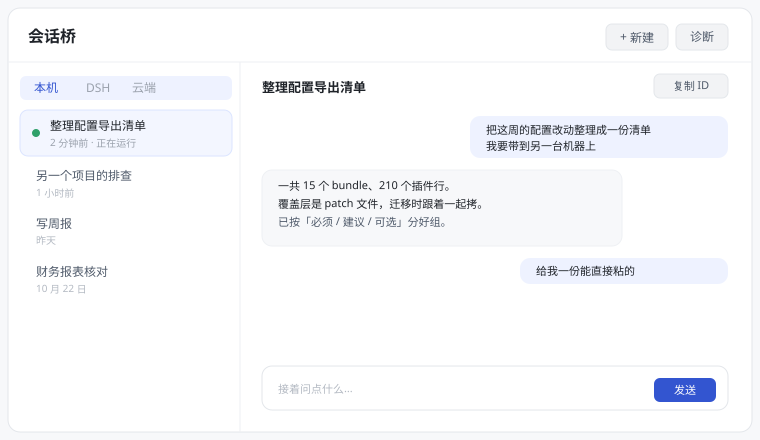

<div align="center">

# 会话桥 · Port DeepSeek Harness → WorkBuddy

**在 WorkBuddy 侧栏装一个「会话桥」：所有会话一屏看完，点开就能接着问。**

[](https://github.com/yhm138/workbuddy-toolkit/actions/workflows/ci.yml)
[](https://github.com/yhm138/workbuddy-toolkit/releases)
[](LICENSE)
[](#装)

</div>



*（示意图，不是截图——仓库里不放带真实会话内容的图片）*

## 装

**不用装 Node.js，不用管理员权限，不改 WorkBuddy 本身的任何文件。**

1. 去 [Releases](https://github.com/yhm138/workbuddy-toolkit/releases) 下载 `port-dsh-to-workbuddy-v*.zip`
2. 解压到任意位置，双击 **`一键安装.cmd`**
3. 弹出「是否允许此应用对你的设备进行更改」→ 点 **是**（没弹窗就跳过，正常）
4. 装完问要不要重启 WorkBuddy → **直接按回车**

重启后左侧栏多出一个 **「会话桥」**，点开就能看到你所有的会话。

| 现象 | 意思 | 怎么办 |
| --- | --- | --- |
| 找不到 `WorkBuddy.exe` | 装在非常规目录 | `install.cmd --root "D:\你的\WorkBuddy"` |
| 说没有权限 | WorkBuddy 在 `Program Files` 下 | 右键 `一键安装.cmd` → 以管理员身份运行 |
| 装好了但侧栏没有 | 客户端没真正重启 | 托盘图标右键 → 退出，等它完全消失，再从桌面图标打开 |
| 面板打开是空白 / 加载失败 | 版本快照没刷新 | 再退出重开一次；还不行双击 `检查状态.cmd` |
| 客户端升级后面板没了 | 升级会整体替换 `resources/` | 退出重开一次即可，守护一般已经补好了。还不行再跑一次 `一键安装.cmd` |

不想用了：双击 **`一键卸载.cmd`**，再重启一次。只删面板和技能，聊天记录都还在。

### 客户端升级后面板会自己回来

WorkBuddy 升级时会整体替换 `resources/` 目录，装在那里的扩展会被一起清掉——这是宿主行为，
改不了。所以安装时会顺带做两件事：

1. 在 `~/.workbuddy/dsh-skills/store/` 留一份扩展副本；
2. 往「启动」文件夹放一个 `WorkBuddySessionBridgeGuard.vbs`，登录时静默拉起守护进程，
   每 2 秒看一次扩展目录。升级把目录清掉、客户端还没重新启动的那几秒里，它就把扩展拷回去。

所以升级后直接重新打开客户端，面板通常已经在了。不想让它在后台待着：
Win+R 输入 `shell:startup`，删掉 `WorkBuddySessionBridgeGuard.vbs`；
或者干脆双击 `一键卸载.cmd`，它会连守护一起收干净。

> 为什么不能把扩展放进 `~/.workbuddy/extensions` 一劳永逸：那两个用户扩展目录里的
> `distribution.json` 不被信任，权限会被降级成空，`service` 也不许 fork，装进去只有空壳面板。


想右键会话直接「复制 Session ID」：那是同一工具集里的 **[copy-session-id](../copy-session-id)**，
本仓库里保留着它最早的原型。

## 用它

面板上方三类会话，点一下切换：

| 标签 | 是什么 |
| --- | --- |
| **本机** | 你这台机器上的 WorkBuddy 会话。扫 `~/.workbuddy/projects/<项目>/<会话>.jsonl`，所以宿主没载入的旧会话也能看到、能读 |
| **DSH** | 如果你装着 DeepSeek Harness，那边的会话也列在这里（走本地 `dsh-as-mcp`） |
| **云端** | WorkBuddy 账号下的云端会话，走宿主登录态 |

选中一条 → 右边是对话记录 → 底部输入框直接接着问。

`+ 新建` 开新会话（可填工作目录和第一句）、`复制 ID` 把 UUID 放进剪贴板、
`停止` 打断正在跑的那一轮、`诊断` 在面板抽风时列出每一环的状态。

三条实现上的小讲究，用的时候能感觉到：

- **DSH 注入的「假用户消息」会被折叠**。DSH 每轮都会往会话里写 runtime context、skill 提醒、
  时间采样，它们的 role 也是 `user`。不认出来就会当成你说的话，时间线全乱。
- **正在跑的那一轮不会冒充回复**。助手还在生成时 `assistantMessage` 整个不存在，
  这时只显示你发出去的提问，底部标「等待本轮结束」，而不是拿提问当回答。
- **断线不空白**。MCP 不通时列表退回扫磁盘历史，明确标「离线」，只是不能新建和发消息。

## 它带的东西

```
extension/      侧栏扩展「会话桥」：面板 + fork 出来的 Node service
skills-pack/    7 个技能 + 本地插件市场清单
src/ bin/       dsh2wb CLI：读 DSH 配置 → 差异报告 → 安装 → 自检
```

**7 个技能**补齐 WorkBuddy 里没有的「读」能力：

| 技能 | 干什么 |
| --- | --- |
| `dsh-parity` | 把 DSH 的 8 条协作约定（中文、结论先行、具体数字、增量交付、不编造、人民币、权限克制、长任务先计划）落到回答里 |
| `dsh-config-port` | 迁移用：导出配置、在新机器复原、四类差异怎么看 |
| `dsh-session-ops` | 跨会话操作统一入口。**默认走 WorkBuddy 原生会话桥，只有点名 DSH 才用 MCP** |
| `dsh-token-usage` | 读 `~/.dsh/token-usage/`，按天 / 模型 / 会话出人民币账单 |
| `dsh-session-search` | 在 DSH 历史会话里全文检索（中文、正则、按工作区/时间过滤） |
| `dsh-session-inspector` | 把一轮会话还原成带时间戳、工具名、参数摘要的时间线 |
| `wb-parity-doctor` | 扩展不出现在侧栏时，按什么顺序排查 |

装完就能用：直接跟 AI 说「看看我这个月 DSH 花了多少 token」，它会自己找 `dsh-token-usage`。

## 为什么不是「装个插件就好」

DSH 里那三件高频小事——**复制 ID**、**让两个会话说话**、**随手新建会话**——在 WorkBuddy 的插件层做不到：

| 层 | 能做什么 | 为什么不够 |
| --- | --- | --- |
| Skill（`~/.workbuddy/skills/`） | 给 Agent 加知识、脚本、流程 | 没有 UI，看会话列表还得读对话输出 |
| Plugin（`.codebuddy-plugin/`） | 打包 skills + agents + hooks | 同上，仍然没有常驻面板 |
| **Extension（本仓库主交付）** | 真正的侧栏 iframe + fork 出来的 sidecar 进程 | 有 UI、有 Node 进程、能调本机 MCP |

检索过市场现有 695 个插件（`codebuddy-plugins-official` 206、`workbuddy-connector-plugins-official` 456、
`cb_teams_marketplace` 29）与 connector 目录：**没有**会话桥接的现成实现，所以自建；
但**协议一行没新造**——桥接复用官方 `cloud-sessions` 的 guest-port 范式，能力直接复用 DSH 自带的 `dsh-as-mcp`。

配置复原度 **67 / 100**（15 个 DSH bundle：原生等价 8 · 本包补齐 6 · 部分覆盖 7 · 需手动 2 · 不可移植 3），
明细见 [`docs/parity-report.md`](docs/parity-report.md)。

---

# 以下是给改代码的人看的

## 命令行

装了面板之后，`dsh2wb.cmd` 可以直接用（不需要另装 Node）：

```bat
dsh2wb.cmd doctor                   :: 自检：技能、扩展、MCP 通道、剩余手工项
dsh2wb.cmd wb-call ping             :: 扩展 service 在不在线
dsh2wb.cmd wb-session <会话ID>       :: 回放某个会话（读磁盘，不依赖宿主）
dsh2wb.cmd bridge-test              :: 端到端验收：新建会话 + 两轮往返
```

完整命令：

```
dsh2wb <command> [profile] [options]

inspect [profile]   分析 DSH 配置 → 差异报告（只读，默认命令）
build   [profile]   生成配置快照 + 报告到仓库
install             安装技能包（技能 + MCP 桥接，自动备份）
install-extension   安装侧栏扩展（需重启客户端）
doctor              检查技能、扩展、MCP 会话工具与剩余手工项
wb-call <method>    调扩展 service 的方法（命令行够不到宿主通道时用这条）
bridge-test         端到端验收：新建 WorkBuddy 会话，双向通信两轮
wb-session [id]     读本地 WorkBuddy 会话记录（不带 id 列最近会话）
```

常用参数：`--profile <dir>`、`--out <dir>`、`--json`、`--dry-run`、`--workbuddy-home <dir>`、
`--workbuddy-root <dir>`、`--yes`。`wb-call` 另收 `--payload <json>` / `--payload-file <p>` / `--timeout <ms>`；
`wb-session` 另收 `--project <片段>` / `--limit <n>` / `--no-tools` / `--no-reasoning`。

## 源码怎么跑

前置：Node ≥ 20.10（技能里的 `session-inspect` / `session-search` 解析 zstd 帧，需 **Node 22+**）。

```bash
node bin/setup.mjs              # 等于双击一键安装
node bin/setup.mjs --status     # 状态
node bin/setup.mjs --uninstall  # 卸载
node --test test/*.test.mjs     # 62 例
node bin/guard.mjs --status     # 升级自愈在不在跑
python test/panel_test.py       # 面板 E2E（Playwright + 假宿主）
```

`setup.mjs` 做五件事：把 `extension/` 拷到客户端扩展目录、把 7 个技能拷到 `~/.workbuddy/skills/`、
装升级自愈并拉起守护、重启客户端、等 service 的 `ping` 返回。**重复跑安全**，
旧版本备份到 `~/.workbuddy/dsh-skills/backups/extension-<时间戳>/`（不再留在扩展目录里）。

改代码后要生效：

| 改了什么 | 要做什么 |
| --- | --- |
| `extension/**` | `node bin/setup.mjs` → 重启客户端 |
| `skills-pack/**` | `node bin/setup.mjs`（技能是拷过去的，同样要重跑） |
| `bin/` `src/` | 直接重跑 |

## 面板能力清单

| 能力 | 实现 |
| --- | --- |
| 列出 DSH 会话（标题 / 工作目录 / 更新时间 / 运行中） | `session_list`，标题取自 `~/.dsh/token-usage/sessions.json` |
| 复制 Session ID | service 侧调用平台剪贴板（win32 `clip` / darwin `pbcopy` / linux `wl-copy`\|`xclip`） |
| 新建 DSH 会话（工作目录 + 第一条任务） | `session_create`，prompt 用 `wait:false` 排队，避免卡面板 |
| 与任一 DSH 会话对话 / 停止 | `session_prompt`（`mode:"queue"`）、`session_cancel`，详情页 3s 轮询 |
| 看某会话最近消息 | `session_messages`；自动识别并折叠 DSH 注入的 runtime context / skill 提醒 / 时间采样 |
| WorkBuddy 会话：行上右键 | 查看 / 在 WorkBuddy 中打开 / 复制 ID、标题、工作目录 / 在资源管理器中显示 |
| 看得到桌面端的 WorkBuddy 会话 | 「本机」源扫 `~/.workbuddy/projects/<项目>/<会话>.jsonl`；「云端」源走 `wb.http.get`（数字 ID，另一套空间） |
| WorkBuddy 新会话 + 双向对话 | `wb:conversations:create` → `sendPrompt`（收 ContentBlock[]）→ `requests` 读回复 |
| 其他本地 harness（Codex / Claude） | 标签页按探测结果动态生成，只读；能看内容 / 复制 ID / 复制恢复命令 |
| 断线降级 | MCP 不通时列表退回扫 `~/.dsh/sessions/` 磁盘历史，显式提示「离线」 |

## 扩展契约（改面板前先读）

**清单两份，字段必须一致**

```json
// extension/extension.json
{ "id": "dsh-session-bridge", "version": "1.0.0",
  "ui": { "entry": { "title": "会话桥", "icon": "./icon.svg", "url": "./ui/index.html",
                      "placement": "sidebar", "openInWindow": false, "keepAlive": true } },
  "service": { "entry": "./server/index.cjs", "process": "fork" } }
```

```json
// extension/distribution.json
{ "extensionId": "dsh-session-bridge", "version": "1.0.0",
  "kind": "builtin", "status": "active", "grantedPermissions": ["*"],
  "processPolicy": { "server": "fork", "renderer": "iframe" } }
```

`kind: "builtin"` 才真正落侧栏；部署在 `resources/app.asar.unpacked/resources/extensions/` 下免签名。

**Guest 桥：10 秒内必须回话**

宿主在 iframe `load` 后 `postMessage({type:"__wb_port_init__", readyToken}, "wb-extension://<id>", [port2])`；
guest 收到后必须立刻用该 port 回一条：

```js
port.postMessage({ type:'wb:invoke:request', requestId, channel:'wb:boundary:guest-ready',
                   args:[{ readyToken }] });
```

超时就报「插件加载失败 / Guest Ready timed out after 10000ms」。所以桥代码要放在 `<head>` 里、不依赖任何资源加载完成。

**两跳 Local RPC，票据短命**

```js
// 1) 拿票（约 5 分钟有效）
const { fallbackToken, methods } = await invoke('wb:extensions:$resolveLocalRpc', [EXT_ID]);
// 2) 用票调用
const res = await invoke('wb:extensions:$invokeLocalRpcFallback',
                         [EXT_ID, 'listDsh', payload, fallbackToken]);
```

错误码 `PERMISSION_DENIED` / `EXTENSION_CONTEXT_STALE` / `EXTENSION_LOCAL_RPC_BUSY` / `INVALID_ARGUMENT`。
面板对前三个做**一次**自愈：清票 → 重新 resolve → 重试。`EXTENSION_LOCAL_RPC_BUSY` 不要循环重试。

**service 侧形状**

```js
function activate(wb) {
  const methods = {
    listDsh: async (context, payload) => ({ ok: true, sessions: [...] }),
  };
  return { methods, dispose() {} };
}
```

* 签名是 `(context, payload)`，**context 在前**——写反了报 `INVALID_ARGUMENT`，且错误信息不会告诉你顺序错了。
* 返回值必须可结构化克隆（不要 Date / class 实例）。
* 方法名不能含 `/`、不能以 `wb:internal:` 开头、≤ 128 字符。
* `wb.http.get(url, {headers})` 带宿主登录态；返回体常被 `{code,msg,data}` 包一层，要 unwrap。
* service 会被 idle evict：别把「进程常驻内存里的状态」当契约。

## 命令行怎么调到宿主通道

`wb.invoke`（`wb:conversations:*` 这类 daemon 通道）只存在于宿主 fork 出来的 service 进程里。
命令行进程没有合法途径拿到 daemon 的 RPC 票据——握手带 nonce + HMAC proof，票据由主进程内存持有、从不落盘。

所以反过来做：**CLI 往 `~/.workbuddy/dsh-skills/bridge-queue/` 丢一个 `.req.json`，service 轮询取走执行，把结果写成 `.res.json`**。

```bash
dsh2wb wb-call ping
dsh2wb wb-call createWb --payload '{"cwd":"D:/your/project"}'
dsh2wb wb-call requestsWb --payload '{"conversationId":"..."}'
```

- 白名单制：只放行会话相关 + 只读方法，不接受任意代码执行
- 请求文件先 `rename` 成 `.taken` 再执行，重复扫描不会跑两遍
- 前提是 service 正在运行（客户端启动时 fork，不需要先点开面板）
- service 被宿主回收后，面板对**只读方法**会自动重取票据再试一次；有副作用的方法不重试（宁可报错，不能重复投递）

## WorkBuddy 会话之间怎么对话

宿主只给了三个通道，形状都和直觉不一样，改之前记住这三条：

| 通道 | 真实形状 | 坑 |
|---|---|---|
| `wb:conversations:create` | 参数对象透传，返回 `{info:{transport:'local'}}` | `cwd` 会被拒，得用 `workspacePath`（service 里三种形态依次试） |
| `wb:conversations:sendPrompt` | 第二个参数必须是 `ContentBlock[]` | 传字符串直接 `INVALID_ARGUMENT` |
| `wb:conversations:requests` | `items[]` 是**一次请求**，含 `userMessage` + `assistantMessage` | 见下 |

`requests` 的三个细节：

1. **`items[]` 不是消息列表**，是请求列表。一轮请求里 `userMessage` 是提问、`assistantMessage` 是回复。
2. **`assistantMessage.content[]` 第一块通常是 `{type:"reasoning"}`**，正文在后面的 `type:"text"` 块里。
   按 `.text` 无脑拼接会把模型思考混进回复——所以解析按类型白名单挑（`text`/`output_text`/`input_text`/`markdown`）。
3. **助手还在跑时 `assistantMessage` 整个不存在**（`state:"streaming"`）。这时只能给一条 user 消息，
   **绝不能拿提问冒充回复**。`bridge-test` 也因此按「assistant 条数增加」判断，而不是「消息变多了」。

`dsh2wb wb-session <id>` 可以直接读 `~/.workbuddy/projects/<项目>/<id>.jsonl` 复盘，不依赖宿主——
`requestsWb` 只吐已完成的请求，本地记录里连注入的 system-reminder 都在，时间线会剔掉它们。
一次真实往返的记录见 [`docs/bridge-demo.md`](docs/bridge-demo.md)。

## 六个反模式

1. 不做聊天输入框：`wb:message:fill` 填不进原会话，要给 `workbuddy://chat/<id>` 深链。
2. `window.open` 恒返回 `null`，开新窗走深链或面板内路由。
3. iframe 里不能 `fetch` 本地 JSON（CORS），用 `<script>` 注入。
4. 不要在顶层 `file://` 测面板——拿不到 port，会一直卡在 10 秒超时。用 `test/panel.html` 假宿主。
5. 不要假设 service 活着；每次调用都可能是一次冷启动。
6. 不要一次性传大对象（会话消息全量塞 RPC 会触发大小限制），分页取。

## 测试

```bash
node --test test/*.test.mjs   # 55 例：service（假 MCP）、YAML 子集、剪贴板、lnk、注入脚本
python test/panel_test.py     # 面板 E2E：Playwright + 假宿主，跑完把截图写进 .probe/
```

`test/menu-inject.test.mjs` 里那个 WebSocket 服务端是按 RFC6455 真实现的——注入器传输层是手写的
（service 是裸 Node 进程，装不了 `ws`），不测协议等于没测。
`test/panel.html` 是一个假 WorkBuddy 宿主（自己发 `__wb_port_init__`、自己答两跳 RPC），
改面板时先在这里跑通，再装到 `extensions/` 下——省掉「重启客户端 → 看日志」的循环。

## 已知缺口

* **不可移植**：`dsh-codex-ui`（宿主 UI，插件无法注入前端）、`steer` 键位、插件市场自定义索引。
  * 例外：会话菜单那一处可以用 CDP 绕过去，已抽成 [`copy-session-id`](../copy-session-id)，
    代价是快捷方式要带调试参数。
* **需手动**：默认模型（`deepseek-flash` + 推理强度 max）、默认权限——**建议不要照搬 `danger-full-access`**，
  改成「工作区可写 + 审批」。
* 扩展目前只在本机（Windows 11 + WorkBuddy 5.9.2）验证；Linux / macOS 的路径探测与剪贴板分支已写但未实测。

## 对照版本

WorkBuddy **5.9.2** · DSH **0.2.1-rc.2** · 校验日期 2026-10-26。版本变化后请重跑 `dsh2wb doctor`。

术语澄清（Bundle / Extension / Plugin / Skill 到底谁是谁）见 [`docs/TERMINOLOGY.md`](docs/TERMINOLOGY.md)；
安装、卸载、回滚与故障排查见 [`docs/install.md`](docs/install.md)。

## License

MIT
